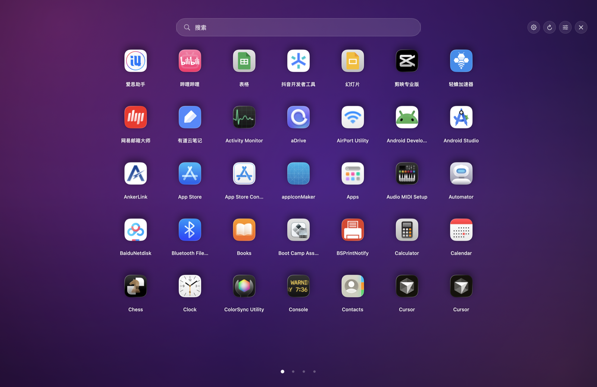
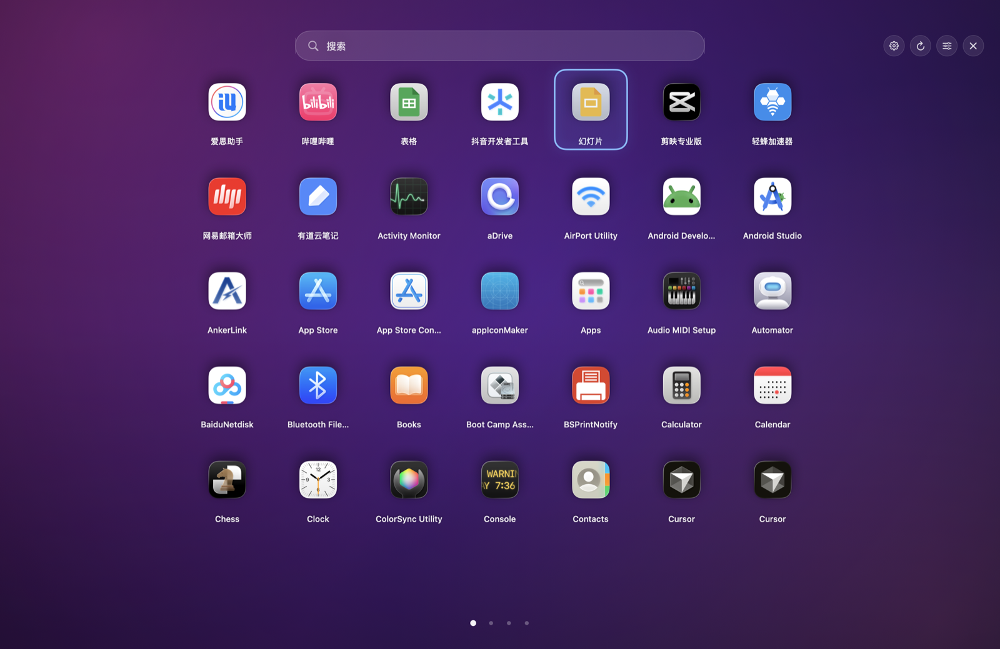
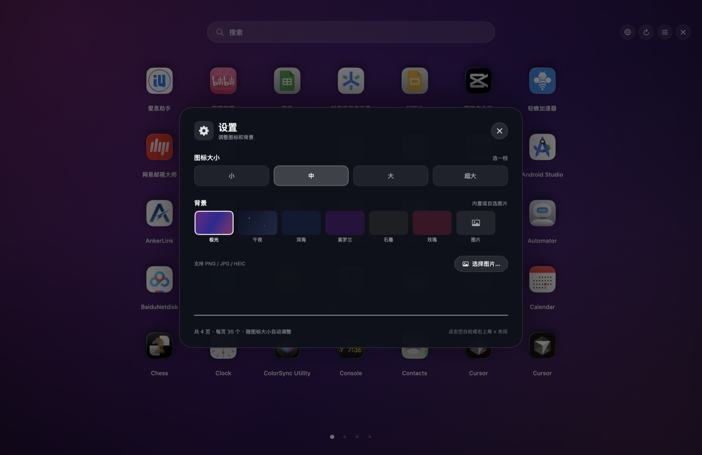
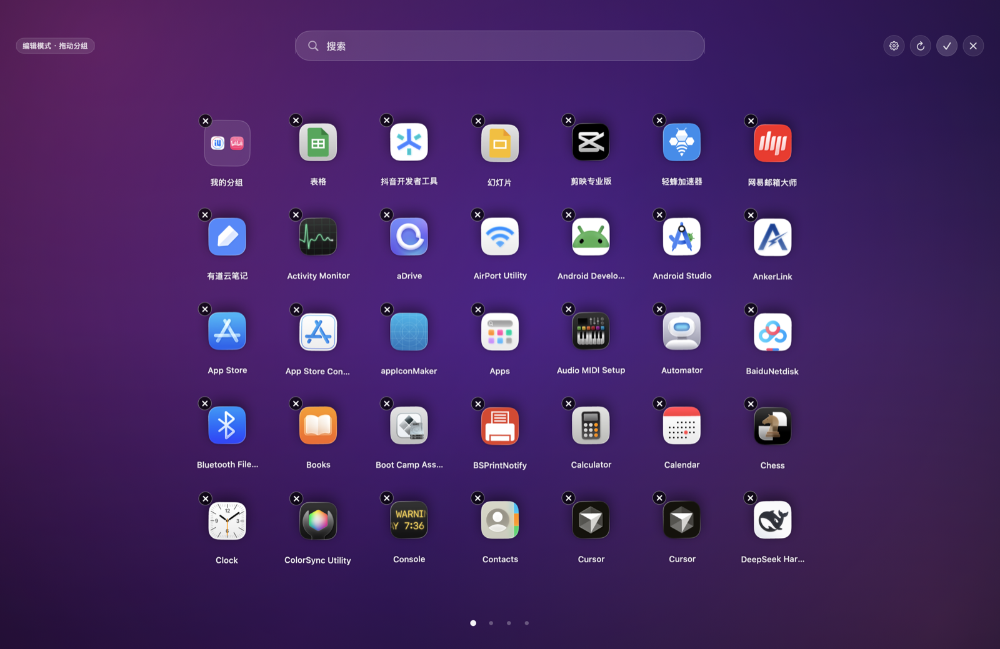
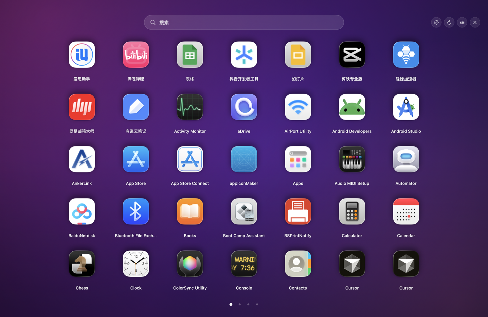
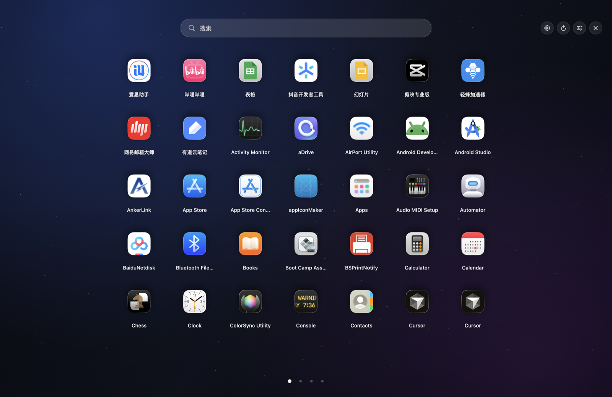
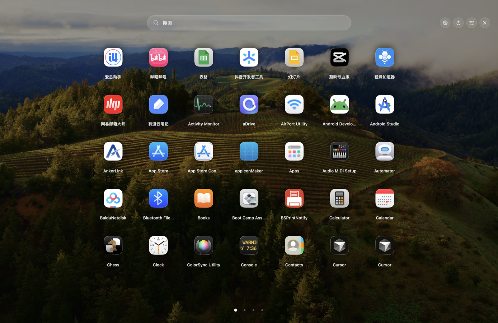
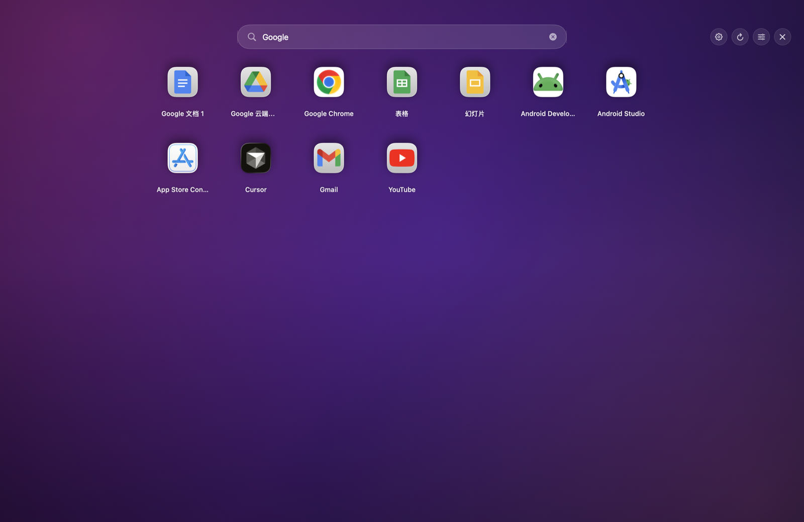

# Dashboard Reborn

macOS 26 “液态玻璃”风格的 Dashboard 替代品：读取本机 App、分页图标网格、搜索、长按编辑、拖拽分组、从面板删除、设置与布局持久化。



> 可行性分析、架构、实施与验收结果见 [PLAN.md](PLAN.md)。

## 已验证

- 构建产物 `dist/Dashboard.app`（ad-hoc 签名，`codesign --verify` 通过）
- 读取到 132 个 App（标准目录原始 139 份，按 bundle id 去重）
- 拖动排序 + 分页顶部对齐：支持页内插入排序，不足一页时靠上排列
- 布局 / 分页 / 排序 / 背景 / 设置逻辑自测 27 项全部通过
- Tab / Shift+Tab / ← / → 真实合成按键测试 5 项全部通过
- 分页手感：触控板横向交回系统 paged scroll（跟手 + 惯性吸附）；鼠标滚轮一次一页，合成滚轮测试 3 项 PASS
- 点击空白背景收起 Dashboard、点击设置遮罩关闭设置，合成点击测试 2 项 PASS
- 分页：容量随图标尺寸 / 页面高度自动计算，中图标 35 个/页、小图标 45 个/页
- 界面参考旧版 Launchpad：顶部只有一个居中大搜索框，无标题栏，彩色渐变背景，底部只有分页圆点
- 设置：图标大小用四档大按钮调；每页容量自动计算，背景可选极光 / 午夜星空 / 纯色 / 自选图片，自动保存
- 顶部搜索：居中大搜索框，已避开刘海 / 菜单栏；按名称/包名实时过滤，见 `docs/search.png`
- 真实面板启动并截图（`docs/screenshot.png`），F12 全局热键注册成功
- LaunchServices 启动成功，布局写入 `~/Library/Application Support/DashboardReborn/layout.json`

## 环境

- macOS 14+（Liquid Glass 效果需要 macOS 26+）
- Xcode 26 / Swift 6.x（项目用 Swift 5 语言模式编译）
- 无第三方依赖：SwiftPM 构建，不需要 CocoaPods
- macOS 原生使用 SwiftUI + AppKit；UIKit 是 iOS 框架，不适用于 macOS 桌面 App

## 构建

```bash
cd DashboardReborn
./build.sh
```

产物：`dist/Dashboard.app`（ad-hoc 签名）。

## 运行

```bash
open dist/Dashboard.app
```

启动后会直接显示一个全屏 Dashboard，同时菜单栏出现一个网格图标。Esc 收起面板；App 会留在菜单栏，点菜单栏图标可以再次打开，或选择“退出 Dashboard”。

> 注意：面板显示时点击其他 App 会自动收起（`hidesOnDeactivate`），不会一直挡在桌面上。

### 操作

| 操作 | 结果 |
|---|---|
| `Tab` / `Shift+Tab` | 选中下一个 / 上一个图标，最后一个之后回到第一个 |
| `←` / `→` | 上一页 / 下一页 |
| 底部圆点 | 直接跳到指定页 |
| `Enter` | 打开当前选中的 App，或进入选中的文件夹 |
| 顶部搜索框 | 居中 620×46，实时过滤；回车打开第一个，Esc 清除 |
| 右上角齿轮 | 打开设置：图标大小、背景 |
| 点击空白背景 | 收起 Dashboard；编辑模式下先退出编辑 |
| 点击设置卡片外遮罩 | 关闭设置 |
| 点击 App 图标 | 打开 App，Dashboard 收起 |
| 长按图标 0.55 秒 | 进入编辑模式，图标抖动 |
| 编辑模式拖到图标中心 | 合成文件夹；拖到文件夹上 → 加入 |
| 编辑模式拖到图标边缘/空隙 | 插入排序，显示白色插入线；拖到空白底部可排到页尾 |
| 点文件夹 | 打开文件夹弹层，可直接改文件夹名 |
| 编辑模式点 × | 从面板移除（不卸载），可在设置面板“全部恢复”加回 |
| 右键图标 | 打开 / 在访达中显示 / 从面板移除 / 移到废纸篓 |
| 点文件夹 × | 解散文件夹，成员回到网格 |
| Esc | 关闭文件夹 → 退出编辑 → 收起面板 |
| F12 | 全局显示/隐藏（部分键盘需按 Fn+F12） |
| 菜单栏图标 | 打开、重新扫描、恢复移除项、重置布局、退出 |

## 键盘选择

按 `Tab` 选中下一个图标，`Shift+Tab` 选中上一个；到最后一个再按 `Tab` 会回到第一个，反之亦然。选中项有蓝色高亮；如果选中项在另一页，会自动翻到那一页。`Enter` 打开。



搜索时 `Tab` 在搜索结果中循环；焦点在搜索框里按 `Tab` 会退出输入并选中第一个结果。

## 分页与设置

每页容量按当前图标尺寸和页面可用高度自动计算，不再需要选择固定数量。中图标约 35 个/页，小图标约 45 个/页；切换图标尺寸会立即重排。底部只显示圆点，点击圆点跳页；键盘 `←` / `→` 也可以。

- 触控板横向滑动：交回系统 paged scroll view，跟手、带惯性并吸附到整页，不再逐事件跳页
- 鼠标滚轮 / 触控板纵向：一次动作翻一页，使用弹簧动画；再次滚动才翻下一页
- 旧版 Launchpad 的翻页也是整页宽的 paged scroll view，手势与吸附由系统处理，而不是监听滚轮后直接跳页
- 滚动条已强制隐藏，不会再出现进度条样式的指示器

右上角齿轮打开设置：

- **图标大小**：小 / 中 / 大 / 超大四档大按钮（64 / 70 / 90 / 100pt）
- **每页容量**：根据图标尺寸与可用高度自动计算，设置页底部会显示当前值

设置会写入 `UserDefaults`，下次启动保持。搜索时在搜索结果中分页。

### 背景

设置面板里的“背景”：

- **极光**：默认的紫粉蓝渐变
- **午夜**：原来的深色星空背景
- **深海 / 紫罗兰 / 石墨 / 玫瑰**：纯色
- **图片**：选择本地 PNG / JPG / HEIC，图片会复制到 Application Support，原文件移走也不影响



> 跨页拖拽分组暂未实现：需要先把两个 App 翻到同一页再拖拽。

## 界面预览

| 编辑模式 | 超大图标 |
|---|---|
|  |  |
| **午夜星空背景** | **自定义图片背景** |
|  |  |

编辑模式支持长按抖动、拖动分组、点 × 移除；图标大小可选小 / 中 / 大 / 超大；背景可选极光、午夜星空、纯色或本地图片。

## 搜索

顶部是居中的 620×46 大搜索框（参考旧版 Launchpad，但更大），按 App 名称或 bundle id 实时过滤，名称命中排在前面；“Google”示例会同时匹配 Google Chrome、Google 文档、Gmail 等。搜索结果从顶部开始排列。



按回车打开第一个结果；`Esc` 先清除搜索，再按一次才会收起面板。

## 数据位置

- 布局：`~/Library/Application Support/DashboardReborn/layout.json`
- 自选背景：`~/Library/Application Support/DashboardReborn/Backgrounds/`
- 图标大小 / 背景选择：`UserDefaults`（bundle id `local.dashboard.reborn`）
- 删除布局文件即可恢复默认布局；设置可在齿轮面板里改回默认值

## 调试命令

```bash
# 只扫描，不启动 UI，输出 JSON
dist/Dashboard.app/Contents/MacOS/Dashboard --scan-json

# 离屏渲染 UI 预览（无需录屏权限）
dist/Dashboard.app/Contents/MacOS/Dashboard --render /tmp/dashboard-preview.png

# 数据层 / 分页 / 排序 / 背景 / 设置自测（27 项）
DASHBOARD_LAYOUT_PATH=/tmp/dash-self.json \
DASHBOARD_SETTINGS_SUITE=dash.self \
dist/Dashboard.app/Contents/MacOS/Dashboard --self-test

# 合成点击：空白背景 / 设置遮罩 dismiss（2 项）
DASHBOARD_LAYOUT_PATH=/tmp/dash-dismiss.json \
DASHBOARD_SETTINGS_SUITE=dash.dismiss \
dist/Dashboard.app/Contents/MacOS/Dashboard --dismiss-test

# 文件选择面板可见性（1 项，自动取消）
DASHBOARD_LAYOUT_PATH=/tmp/dash-picker.json \
DASHBOARD_SETTINGS_SUITE=dash.picker \
dist/Dashboard.app/Contents/MacOS/Dashboard --picker-test

# 合成鼠标滚轮：一次滚动只翻一页（3 项）
DASHBOARD_LAYOUT_PATH=/tmp/dash-scroll.json \
DASHBOARD_SETTINGS_SUITE=dash.scroll \
dist/Dashboard.app/Contents/MacOS/Dashboard --scroll-test

# 合成 Tab / Shift+Tab / ← / → 按键测试（5 项）
DASHBOARD_LAYOUT_PATH=/tmp/dash-key.json \
DASHBOARD_SETTINGS_SUITE=dash.key \
dist/Dashboard.app/Contents/MacOS/Dashboard --key-test
```

## 能力边界

- 不能创建系统级 Dashboard Space，也不能接管四指横扫；用置顶无边框面板 + F12 近似。
- “×”只从面板移除；真正卸载走右键“移到废纸篓”，由系统弹授权。
- 沙盒（Mac App Store）会限制扫描 `/Applications`；本项目按 Developer ID 直接分发设计。
- 旧版 `.wdgt` 小组件不能直接复用；当前版本聚焦 App 图标管理。

## 目录

```
DashboardReborn/
├── Package.swift
├── PLAN.md
├── build.sh
├── Support/Info.plist
└── Sources/
    ├── AppMain.swift
    ├── AppDelegate.swift
    ├── DashboardController.swift
    ├── DashboardModel.swift
    ├── AppScanner.swift
    ├── LayoutStore.swift
    ├── Models.swift
    ├── IconProvider.swift
    ├── GlobalHotKey.swift
    ├── DashboardView.swift
    ├── TileView.swift
    ├── FolderOverlay.swift
    ├── DashboardBackground.swift
    ├── SettingsOverlay.swift
    └── GlassStyle.swift
```
